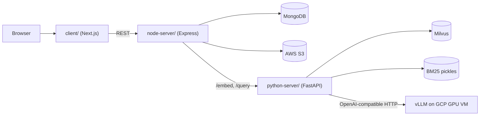

# RAG Chat with PDF

Capstone project. Users upload PDF, DOCX or TXT files into a **workspace**, then chat with them. Answers come from a Vietnamese-tuned Llama 3.2 3B model, grounded in passages found by hybrid (dense + BM25) retrieval. Each answer carries its source passages.

> **Status:** working prototype for a single host. The Docker Compose stack builds but has not been run end to end against real MongoDB, S3 and vLLM. Read [Known issues](docs/project-roadmap.md) before deploying or demoing on a shared network.

## How it fits together



| Path | Role |
|---|---|
| `client/` | Chat UI, auth screens, workspace creation |
| `node-server/` | Auth, workspaces, chat history, S3 upload, proxy to the RAG service |
| `python-server/` | Chunking, embedding, hybrid retrieval, prompt building, LLM call |
| `translator/` | Offline: translate English instruction datasets to Vietnamese |
| `llm/` | Offline: LoRA fine-tune of Llama 3.2 3B on the translated data |

## Quick start (local)

Run the infrastructure in Docker and the three apps on the host. node-server passes downloaded file paths to python-server during embedding, so both must read the same directory. Use Node 22 for node-server. See the [deployment guide](docs/deployment-guide.md) for the full environment reference.

```bash
docker-compose up -d etcd minio milvus          # Milvus on :19530; wait for it to report healthy

# Each in its own terminal, from the repo root:
cd python-server && pip install -r requirements.txt && python app/main.py   # :8080
cd node-server   && yarn install && yarn dev                                # :8000 (needs node-server/.env)
cd client        && yarn install && yarn dev                                # :3000 (needs client/.env.local)
```

To run everything in containers instead, create a root `.env` and run `docker-compose up -d --build` ([details](docs/deployment-guide.md#docker-compose)).

## Documentation

| Doc | Read it for |
|---|---|
| [project-overview-pdr.md](docs/project-overview-pdr.md) | Product intent, scope, terminology, key decisions |
| [system-architecture.md](docs/system-architecture.md) | Embed, query and auth flows, data ownership, trust boundaries |
| [codebase-summary.md](docs/codebase-summary.md) | Where things live and where to start a change |
| [code-standards.md](docs/code-standards.md) | Conventions, response shapes, logging and testing rules |
| [design-guidelines.md](docs/design-guidelines.md) | UI tokens, components, theming |
| [deployment-guide.md](docs/deployment-guide.md) | Environment variables, local run, Docker, LLM server, troubleshooting |
| [project-roadmap.md](docs/project-roadmap.md) | Verified known issues, evaluation snapshot, open decisions |

AI coding agents should also read [CLAUDE.md](CLAUDE.md).

## Contributing

- Commits follow [Conventional Commits](https://www.conventionalcommits.org/).
- No automated tests exist yet. Verify changes by running the stack. See [code-standards.md](docs/code-standards.md#testing).
- Never commit credentials. Several have leaked in the past; see [Known issues](docs/project-roadmap.md#security).
