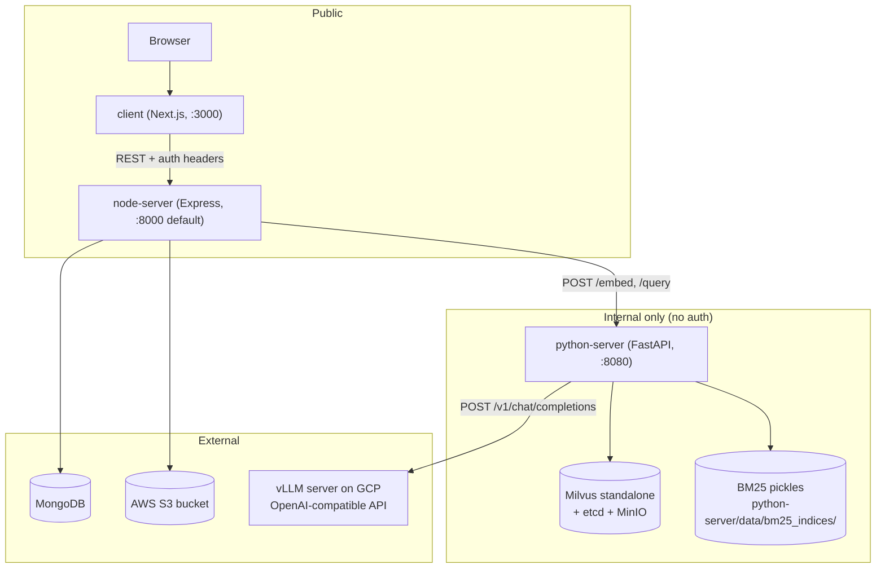
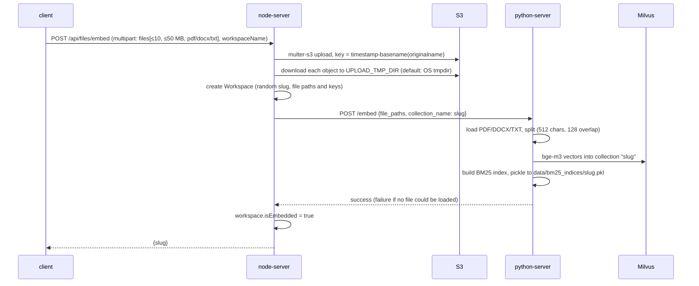
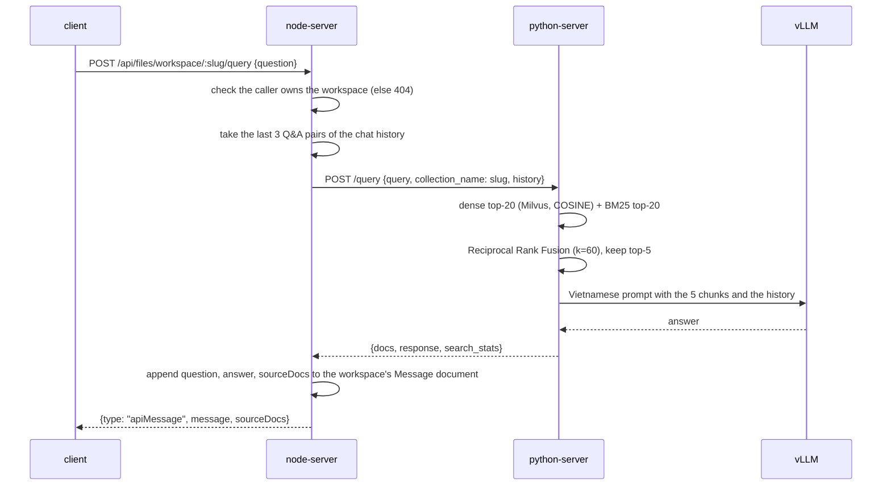
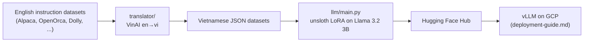

# System Architecture

Why the system is shaped this way: [project-overview-pdr.md](project-overview-pdr.md#key-decisions). Known defects in these flows: [project-roadmap.md](project-roadmap.md).

## Components and trust boundaries



- **node-server** is the only component that authenticates callers and checks workspace ownership. Anything that reaches python-server is trusted, so Compose binds it to localhost only.
- **python-server** reads files from paths that node-server gives it. The two must share a directory (`UPLOAD_TMP_DIR`); see [Embed flow](#embed-flow).
- **MongoDB** holds users, keys, workspaces and chat history. **S3** holds the original uploads. **Milvus + BM25 files** hold the derived search indexes and can be rebuilt from the originals.

## Embed flow

A workspace is created and indexed in one synchronous HTTP request.



Owners: `node-server/src/services/files.service.ts` (`embedFiles`), `python-server/app/services/rag_service.py` (`embed_documents`).

## Query flow



Retrieval parameters are read from `python-server/config.yaml` (`document_processing`, `hybrid_search`, `bm25_index_dir`). Several other keys in that file are not read by the code; grep `app/` for a key before trusting it. The cross-encoder reranker exists in `app/core/vector_stores/milvus.py` but runs only on the non-hybrid path.

Owners: `files.service.ts` (`queryWorkspace`), `rag_service.py` (`query_documents`), `app/core/retrievers/hybrid_searcher.py`, `app/core/fusion/score_fusion.py`.

## Authentication

```mermaid
sequenceDiagram
    participant C as client
    participant N as node-server
    participant DB as MongoDB
    C->>N: POST /api/auth/login {email, password}
    N->>DB: verify bcrypt hash; load UserKeyPair (create if missing)
    N->>N: decrypt private key with MASTER_ENCRYPTION_KEY
    N->>N: sign access + refresh JWT (RS256, payload {user: {_id, email, name}}) with the user's private key
    N->>DB: upsert Keystore {client: userId, publicKey}
    N-->>C: {tokens, keyId, publicKey, user}
    C->>N: any request with headers authorization, client-id
    N->>DB: Keystore by client-id
    N->>N: verify the access token (RS256 only) with the keystore's public key
    C->>N: on 401 "jwt expired": POST /api/auth/refresh-token with headers refresh-token, client-id
    N->>N: verify the refresh token; reject (and delete the Keystore) if it was already used
    N-->>C: new token pair
```

- Headers are `authorization` (the raw access token, with no `Bearer` prefix), `refresh-token` and `client-id` (the user's `_id`). They are set by the Axios interceptor in `client/utils/axios.ts`. Only the refresh endpoint accepts the refresh token; every other route requires the access token.
- Auth failures return 401. The message `jwt expired` makes the client refresh; any other message (`Unauthorized`) makes it log out.
- There is one Keystore record per user. Logout, or reuse of a spent refresh token, deletes it, which invalidates every token the user holds.
- Login and register are rate-limited (`node-server/src/middlewares/rate-limit.middleware.ts`).
- `MASTER_ENCRYPTION_KEY` must stay constant across restarts. Without it, the server generates a random key per process, and every stored private key becomes unreadable. Login then fails for all existing users.
- `POST /api/auth/encrypt` and `/decrypt` are general-purpose utilities. Chat messages are stored in plaintext.

Owners: `node-server/src/utils/auth.util.ts` (`authentication` middleware), `src/services/auth.service.ts`, `src/services/encryption.service.ts`, `src/utils/encryption.util.ts`, `src/utils/jwt.ts`.

## Data ownership

| Store | Holds | Defined in |
|---|---|---|
| MongoDB | Users, ApiKeys (unused), Keystores, UserKeyPairs, Workspaces, Messages | `node-server/src/models/` |
| S3 | Original uploads, flat keys `timestamp-filename` with no per-user prefix | `node-server/src/middlewares/multer.middleware.ts` |
| Milvus | One collection per workspace slug | `python-server/app/core/vector_stores/milvus.py` |
| BM25 files | One pickle per workspace slug, relative to python-server's working directory | `python-server/app/core/indices/bm25_index.py` |

Chat history is a single Message document per workspace slug. Each Q&A pair is pushed onto its `messages` array (`node-server/src/repositories/message.repo.ts`).

## Offline pipelines

`translator/` and `llm/` do not run with the app. They produced the model that the app calls.


